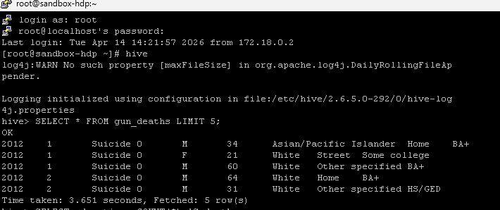
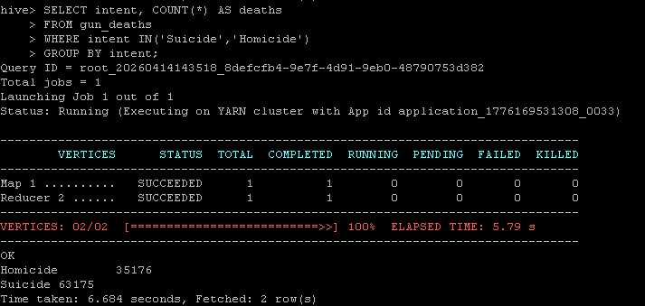
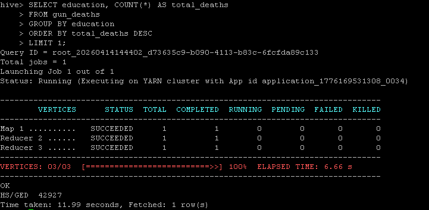
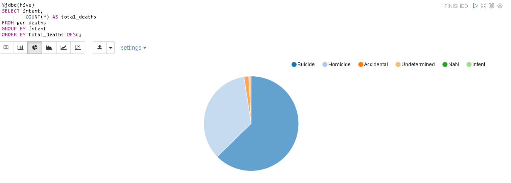
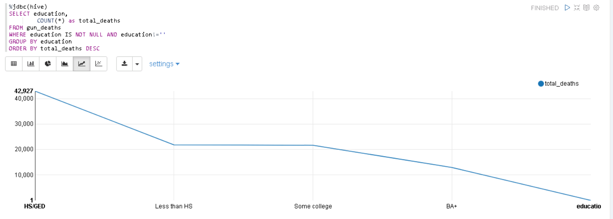
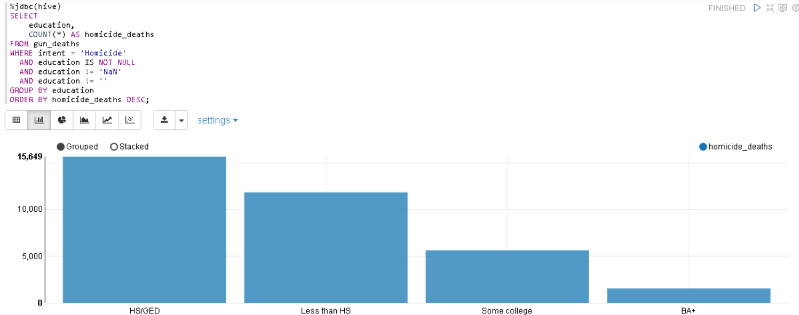

# Influence of Education on Firearm Mortality – Big Data Analysis

Big Data analysis of **100,798 US gun deaths** (CDC data) to examine how **education level** relates to firearm mortality, built on the **Hadoop ecosystem: HDFS, Hive and Apache Zeppelin**.

> MSc Computer Science and Technology · Ulster University · Module **COM745 Big Data and Infrastructure**

---

## Project Resources

- **Recorded demonstration** (5 min): [Watch on Google Drive](https://drive.google.com/file/d/1d-10-PfrflpXt4vC0djfiPgFNv5qKVtc/view?usp=sharing)
- **Presentation**: [`presentation.pdf`](presentation.pdf)
- **HiveQL queries**: [`queries.hql`](queries.hql)
- **Screenshots** of every step: [`images/`](images)

---

## Problem

Firearm mortality is a major public health issue in the USA. Most research focuses on race, age, rurality and gun ownership, while **education is rarely treated as a main factor**. This project compares education level directly against gun deaths.

## Dataset

**Gun Deaths in America – CDC** (Kaggle): 100,798 rows, 9 columns.

| Columns | year, month, intent, police, sex, age, race, place, education |
|---|---|
| **Intent** | Suicide, Homicide, Accidental, Undetermined |
| **Education** | Less than HS, HS/GED, Some college, BA+ |

---

## Architecture

```
Kaggle CSV ──PuTTY/SSH──▶ HDFS ──▶ Hive (database cw2, table gun_deaths)
                                        │
                                        ├── HiveQL analysis (Hive CLI, Tez on YARN)
                                        └── Apache Zeppelin (%jdbc(hive)) ──▶ charts
```

| Layer | Tool | Role |
|-------|------|------|
| Access | PuTTY (SSH) | Connect to the Hadoop cluster and upload data |
| Storage | **HDFS** | Distributed, fault-tolerant storage of the dataset |
| Processing | **Apache Hive** (HiveQL, Tez on YARN) | SQL-style querying of the data in HDFS |
| Visualisation | **Apache Zeppelin** | Notebook charts: pie, line, bar |

---

## Pipeline

### 1. Ingest to HDFS
```bash
hdfs dfs -mkdir /user/hadoop/mydataset
hdfs dfs -put /root/Assignment.csv /user/hadoop/mydataset
```


### 2. Load into Hive
Created database `cw2` and table `gun_deaths`, then loaded the CSV and verified it.


### 3. Analyse with HiveQL
Used `COUNT(*)`, `GROUP BY`, `WHERE … IN` and `ORDER BY`. The full set is in [`queries.hql`](queries.hql).

| Suicide vs homicide | Education with most deaths |
|---|---|
|  |  |

### 4. Visualise in Zeppelin
Queries were run with the `%jdbc(hive)` interpreter and charted.

---

## Results

**Deaths by intent:** suicide makes up nearly two-thirds of all gun deaths.

| Intent | Deaths |
|---|---|
| Suicide | 63,175 |
| Homicide | 35,176 |
| Accidental | 1,639 |
| Undetermined | 807 |



**Deaths by education:** higher education is linked to fewer gun deaths.

| Education | Total | Suicide | Homicide |
|---|---|---|---|
| HS/GED | 42,927 | 26,321 | 15,649 |
| Less than HS | 21,823 | 9,292 | 11,839 |
| Some college | 21,680 | 15,533 | 5,640 |
| BA+ | 12,946 | 11,147 | 1,559 |




### Key insights
- **HS/GED** has the most gun deaths, nearly double the next group.
- **BA+** has the fewest deaths overall and about **90% fewer homicides** than HS/GED.
- **Less than HS** is the only group where homicide exceeds suicide.
- Education **strongly protects against homicide** but only **weakly against suicide**.

## Limitations and Future Work
- Education categories may hide socioeconomic factors; mental health and income aren't in the data.
- Findings may not generalise beyond the US.
- Future work: add years, states, gun ownership, poverty and mental-health data, and explore education × age, gender or location.

---

## Author
**Eru Poudel** ([@Eru0705](https://github.com/Eru0705)) · MSc Computer Science and Technology, Ulster University
